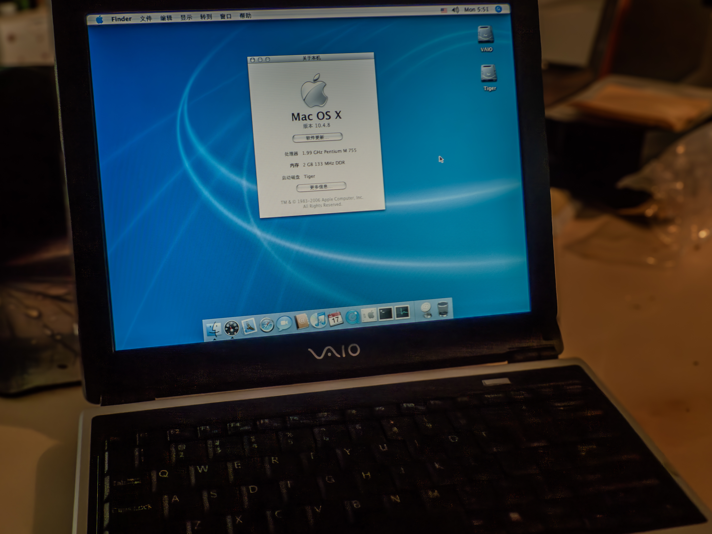

# OSX for SONY VAIO

[简体中文](README.md) · **English**

**Bring Mac OS X to VAIO hardware, and preserve the actual work along the way.**

[](https://github.com/Allannn-sudo/OSX-for-SONY-VAIO/actions/workflows/offline-checks.yml)


[](https://github.com/Allannn-sudo/OSX-for-SONY-VAIO/stargazers)

A personal hardware project exploring Mac OS X on Sony VAIO computers, with model-specific records of installation, drivers, boot behavior, failures and recovery. The first machine, **VGN-Y18C, has reached the Tiger 10.4.8 desktop**. Reliable input, wireless networking and sleep remain under investigation. Updated **2026-10-19**.



*The first machine, photographed by the project owner. About This Mac text has received cosmetic changes; reaching the desktop does not establish complete hardware support.*

## Why this project exists

In an interview published by Nobuyuki Hayashi, Kunitake Ando recalled Jobs showing Sony a VAIO running Mac OS. That unrealized direction inspires this exploration of the VAIO + Mac OS X experience. The original account retains uncertainty about dates and the exact system. [Original interviewer's article](https://nobi.com/en/Steve%20Jobs%20and%20Japan/entry-1212.html)

This is a present-day retrocomputing project. VGN-Y18C and Tiger 10.4.8 are the choices for this experiment. See the [English background](docs/STORY.en.md).

## Project progress

| Area | Confirmed result | Current work |
| --- | --- | --- |
| First model: VGN-Y18C | USB installation completed; Tiger desktop reached on the internal disk | Preserve a bootable baseline and repair input |
| XP and boot | XP partition retained and previously booted; Darwin menu configured | Complete post-recovery dual-boot round trip pending |
| Built-in keyboard / touchpad | Work in BIOS, boot menu and XP; briefly worked in Tiger | Reliable Tiger initialization and binding unresolved |
| Wi-Fi / sleep | Historical driver and power reports investigated | Successful networking and sleep/wake unverified |
| PS/2 source research | R2 loader panic identified; R3 fixes that build defect offline | Runtime deadlines, IRQ handling and hardware validation pending |
| More VAIO models | VGN-Y18C is currently the only documented physical machine | Gather evidence-backed reports and add profiles individually |

[English progress report](docs/PROGRESS.en.md) · [中文进度](docs/PROGRESS.zh-CN.md)

## Model profiles and branches

| Entry | Purpose |
| --- | --- |
| `main`, this page | Overall project, roadmap and model index |
| [VGN-Y18C profile](models/vgn-y18c/README.en.md) | Desktop milestone, configuration, validation limits and open problems |
| [`vgn-y18c` branch](https://github.com/Allannn-sudo/OSX-for-SONY-VAIO/tree/vgn-y18c) | A stage snapshot with its own model home page, created by the manual workflow |
| `feature/<change>` | A focused change reviewed and merged through a pull request |

**After replacing files and committing them to `main`, run Actions → Create VGN-Y18C branch once.** This creates a real Git branch and installs its model-specific home pages. An existing branch is left untouched. A ZIP upload alone does not carry remote branch references. [English setup guide](docs/GITHUB.en.md)

## Next steps

- [x] Install Tiger on the first VAIO through USB and preserve its hardware photo.
- [x] Record real failures, original-controller recovery and offline loader analysis.
- [x] Organize bilingual profiles, portable tests and a model-branch setup workflow.
- [ ] Obtain fresh post-recovery input state; address runtime deadlines and error propagation.
- [ ] After sufficient offline evidence, evaluate external diagnostics isolated from internal files.
- [ ] Once input is reliable, validate Wi-Fi, sleep and dual-boot round trips separately.

## Participate

Use the [issue forms](https://github.com/Allannn-sudo/OSX-for-SONY-VAIO/issues/new/choose) for reproducible machine reports and problems, and real pull requests for documentation, analysis and code. Discussions can host questions and experience once enabled in repository settings. [Contributing](CONTRIBUTING.en.md)

The repository includes test-status badges, a PR template, issue forms and GitHub Actions. GitHub awards personal Achievements for actual activity, separately from repository status badges. [Achievements and participation](docs/GITHUB.en.md)

## Source and checks

The repository retains `drivers/`, `scripts/`, `tests/`, `tools/`, `evidence/` and bilingual `docs/`. R2 is withdrawn. R3-OFFLINE has not been loaded on the VAIO and retains runtime risks. **There is no driver installation entry point.**

On a modern development host:

```sh
python3 -B -m unittest discover -s tests -v
c++ -std=c++11 -Wall -Wextra -Werror scripts/ps2_init_protocol_sim.cpp -o /tmp/vaio-ps2-protocol-sim
/tmp/vaio-ps2-protocol-sim
```

[Offline build](docs/BUILD.en.md) · [Archive scope](docs/ARCHIVE.en.md) · [Third-party sources](THIRD_PARTY_NOTICES.md) · [License scope](LICENSE.md)

Installation media, Apple system/driver binaries, SDKs, raw private diagnostics and personal backups remain local. This project is independent of Apple, Sony and VAIO.
